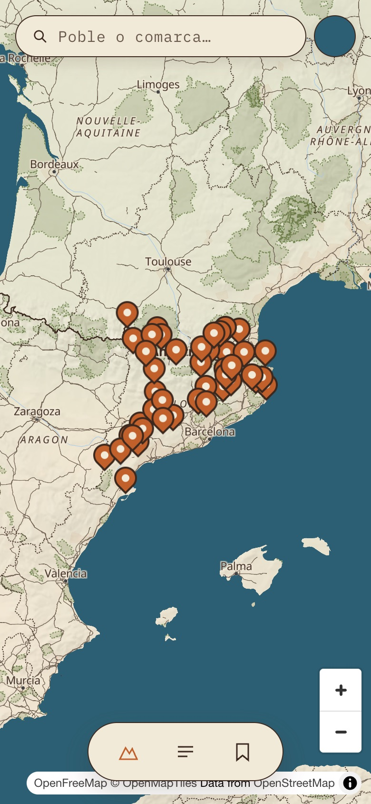
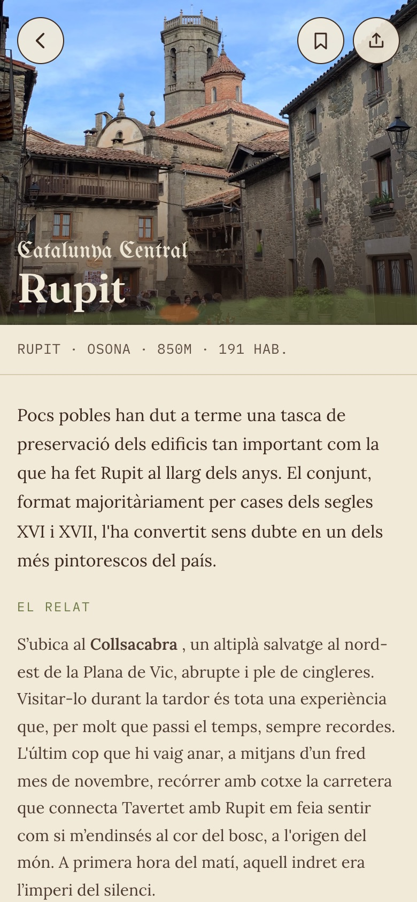

# Medievalismes

Aplicación web para descubrir el patrimonio medieval de Cataluña: un mapa con pueblos, iglesias, castillos y miradores, y una ficha por cada lugar con su historia, sus puntos destacados y su galería de fotos.

**Demo:** [medievalismes.netlify.app](https://medievalismes.netlify.app) (pensada para móvil; el contenido está en catalán).

<p align="center">
  
  &nbsp;&nbsp;
  
</p>

## Qué hace

- **Mapa interactivo** de lugares y, al acercarse a un pueblo, de sus puntos destacados (iglesias, castillos, miradores, senderos).
- **Fichas de lugar** con introducción, relato, puntos destacados desplegables, galería a pantalla completa, botón de compartir y **lugares cercanos** calculados a partir de las coordenadas.
- **Búsqueda con autocompletado** y filtros, y **colecciones temáticas** (por ejemplo, iglesias románicas del Collsacabra).
- **Lugares guardados**: se guardan en el dispositivo y, si la persona inicia sesión (con Google o con un enlace por correo, sin contraseñas), se sincronizan entre dispositivos. Iniciar sesión es opcional: toda la app funciona sin cuenta.
- **Contenido gestionado desde un CMS**, para que quien escribe los textos pueda editarlos sin tocar el código.
- Sin analítica ni cookies de seguimiento. Incluye página de privacidad.

## Tecnología

| Parte | Con qué |
| --- | --- |
| App | Angular 21 (componentes standalone, signals, rutas con carga diferida) y TypeScript |
| Mapa | MapLibre GL con mapas de OpenFreeMap / OpenStreetMap |
| Contenido | Sanity (headless CMS); el Studio está en [`studio/`](studio) |
| Cuentas y datos de usuario | Firebase Authentication y Firestore |
| Despliegue | Netlify |
| Pruebas | Vitest |

## Decisiones de diseño

- **El contenido se carga antes de arrancar la app** (`provideAppInitializer`), así que el resto de componentes lo leen de forma síncrona. Si el CMS no responde o no tiene nada publicado, la app usa un contenido de muestra incluido en el código, y sigue funcionando.
- **Las fotos se piden al tamaño que hace falta** (miniatura o pantalla completa) a través del CDN de Sanity, en lugar de descargar la imagen original siempre.
- **Los textos admiten solo negrita y cursiva** en el Studio, para que todas las fichas mantengan el mismo aspecto.
- **Reglas de Firestore estrictas** ([`firestore.rules`](firestore.rules)): cada persona solo puede leer y escribir su propio documento, y ese documento solo puede contener la lista de lugares guardados.
- **Diseño propio con tokens** ([`src/app/design`](src/app/design)): colores, tipografía y espaciado definidos en un único sitio.

## Cómo ejecutarlo

Necesitas Node 20.19 o superior (se despliega con Node 22).

```bash
npm install
npm start
```

La app queda en `http://localhost:4200/`. Lee el contenido publicado de mi proyecto de Sanity, que es de lectura pública y no necesita ninguna clave.

Para abrir el Studio (edición de contenidos, requiere permisos en el proyecto de Sanity):

```bash
cd studio
npm install
npm run dev
```

Para generar la versión de producción: `npm run build`.

## Sobre el proyecto

Proyecto personal. La idea, el diseño del producto y las decisiones son mías, y el código lo he desarrollado con asistencia de IA. Los textos y las fotografías de los lugares los aporta una cuenta de divulgación de historia del arte, con su permiso.

El código se publica como muestra de portfolio. Los contenidos y las fotos pertenecen a sus autores y no están disponibles para su reutilización.

---

**Ruth Chavarrías Pascual** · Desarrolladora web junior · [ruthchavar.com](https://ruthchavar.com) · [LinkedIn](https://www.linkedin.com/in/ruthchavar)
